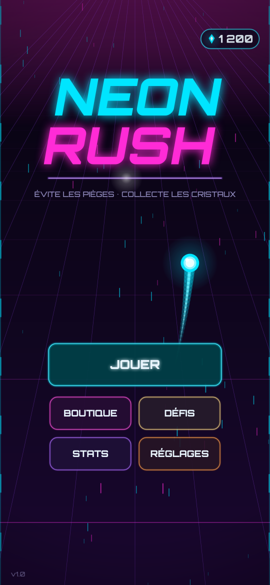
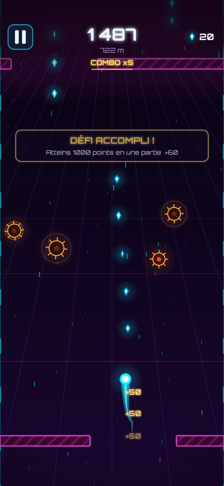
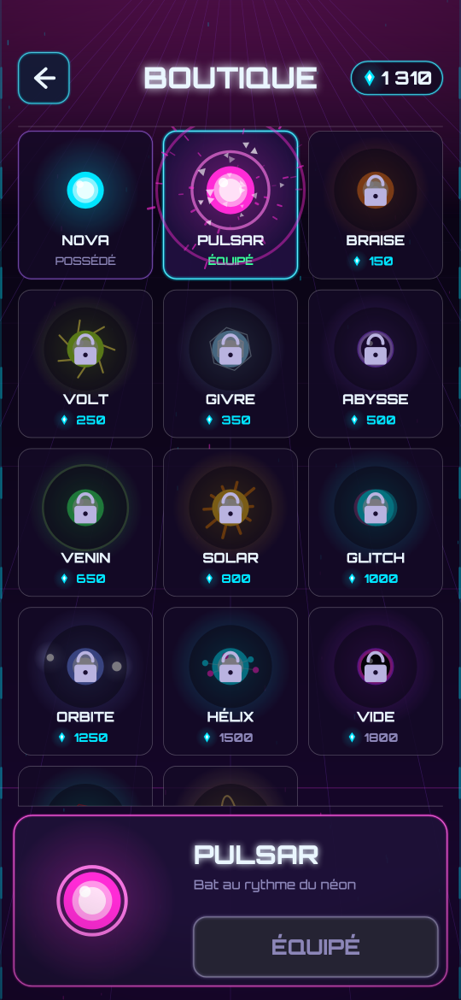

# Neon Rush

Jeu d'arcade Android en vue de dessus : une sphère lumineuse fonce dans une grille cyberpunk.
Glisse le doigt pour l'esquiver entre murs, lasers, mines, rotors et zones électrifiées, ramasse les
cristaux et débloque 14 skins.

**APK prêt à installer : [`release/NeonRush-1.0.0.apk`](release/NeonRush-1.0.0.apk)**
(Android 8.0+ ; signé avec une clé de développement).

  

## Installer sur le téléphone

1. Copier `release/NeonRush-1.0.0.apk` sur le téléphone (ou le télécharger depuis GitHub).
2. L'ouvrir et autoriser « Installer des applis inconnues » pour l'appli utilisée (Fichiers, Chrome…).
3. Ou en USB : `adb install -r release/NeonRush-1.0.0.apk`.

## Contenu du jeu

| Élément | Détail |
|---|---|
| Contrôle | Glissement relatif du doigt, lissage exponentiel + vitesse latérale max, 3 sensibilités |
| Obstacles | Barrières, tunnels, blocs mobiles, lasers (off → alerte → actif), rotors, mines, zones électrifiées |
| Génération | 13 motifs procéduraux pondérés par la difficulté ; espacement fonction de la vitesse |
| Difficulté | Vitesse 560 → 1420 u/s, ouvertures qui se resserrent, motifs plus durs débloqués progressivement |
| Score | Distance (m) + cristaux × combo (jusqu'à x5) + frôlements (+25) + bonus (+50) |
| Bonus | Bouclier (absorbe un choc), Aimant (8 s), Cristaux x2 (10 s) |
| Progression | Monnaie = cristaux, 14 skins (0 à 2 800), défis infinis à paliers (9 types, 3 actifs) |
| Stats | Meilleur score, distance, survie, combo, parties, distance/cristaux/temps totaux, frôlements, bonus, défis, skins |
| Réglages | Musique, effets sonores, vibration (non/faible/forte), sensibilité, pause auto, décompte de reprise, réinitialisation |
| Audio | Musique synthwave et effets 100 % synthétisés par le code au démarrage (aucun fichier audio externe) |
| Hors ligne | Aucun compte, aucune pub, aucun réseau, aucune permission sauf `VIBRATE` |

## Architecture

```
app/src/main/java/com/neonrush/
├── core/                 Logique pure Java (aucune dépendance Android, testée sur JVM)
│   ├── GameWorld.java    Simulation : joueur, collisions (pas fixe 1/120 s), ramassage, combos, bonus
│   ├── Spawner.java      Génération procédurale par motifs
│   ├── Obstacle.java     Obstacles = fonctions pures du temps (collisions déterministes)
│   ├── Pickup.java, Rng.java
│   ├── Profile.java      Sauvegarde : monnaie, skins, stats, défis, réglages
│   ├── Mission.java      Défis à paliers
│   ├── Skins.java        Catalogue des 14 skins
│   └── SaveStore.java    Interface de stockage
└── app/                  Couche Android
    ├── MainActivity      Plein écran immersif, portrait, retour système
    ├── GameView          SurfaceView + thread de jeu (canvas matériel, 60 FPS), file d'entrées
    ├── Game              Ressources partagées, écrans, transitions en fondu
    ├── *Screen           Menu, Jeu, Boutique, Stats, Défis, Réglages
    ├── WorldRenderer, SkinPainter, Backdrop, Particles, Gfx   Rendu néon sans allocation par image
    ├── AudioEngine, Synth  Musique en streaming (AudioTrack) + SoundPool, synthèse procédurale
    ├── Haptics, PrefsStore (SharedPreferences)
```

Aucune bibliothèque tierce dans l'APK (Android SDK uniquement). Police Orbitron (SIL OFL, `app/src/main/assets/fonts/OFL.txt`).

## Compiler

Prérequis : JDK 17+ (testé avec 21), Android SDK (platform 35, build-tools 35.0.0).

```bash
echo "sdk.dir=/chemin/vers/Android/Sdk" > local.properties   # ou variable ANDROID_HOME
./gradlew assembleRelease          # APK signé : app/build/outputs/apk/release/app-release.apk
./gradlew assembleDebug            # APK debug
./gradlew testDebugUnitTest        # tests (gameplay JVM + rendu Robolectric -> docs/screenshots/)
./gradlew lintRelease
```

Android Studio : *File → Open* sur le dossier racine, puis *Build → Build APK(s)*.

### Signature

`keystore/neonrush-dev.jks` (alias `neonrush`, mots de passe `neonrush`) est une **clé de développement**
versionnée volontairement pour que chaque build soit installable par-dessus la précédente.
Pour publier sur le Play Store, créer une clé privée et remplacer le bloc `signingConfigs.dev` de
`app/build.gradle` (ne jamais versionner une vraie clé).

### Modifier le jeu

- Difficulté / vitesse : `GameWorld.speedAt`, `GameWorld.difficultyAt`, espacement dans `Spawner.spawnNext`.
- Nouveaux motifs : ajouter une méthode dans `Spawner` + son poids dans `WEIGHT`/`MIN_D`.
- Skins : une ligne dans `Skins.ALL` (couleurs, style de traînée, décoration).
- Défis : tableaux `TARGETS`/`REWARDS` de `Mission`.
- Musique : `Synth.music` (accords `CHORDS`, mélodie `LEAD`, tempo).

Rapport de tests : [VALIDATION.md](VALIDATION.md).
